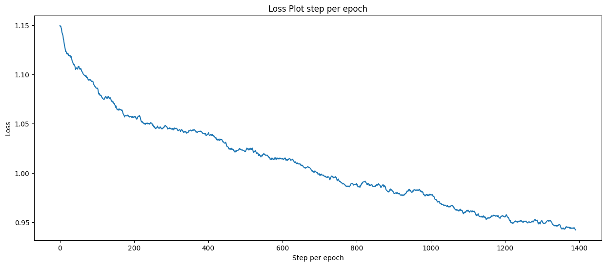

# LMSYS Chatbot Arena: predicting human preference with Gemma 2 9B on TPU

My training notebook for the Kaggle competition
[LMSYS – Chatbot Arena Human Preference Predictions](https://www.kaggle.com/competitions/lmsys-chatbot-arena) (2024).
My final standing in the competition: 305th of 1,688 teams (top 18%) on the private leaderboard.

## The task

In Chatbot Arena, a person asks a question, two anonymous chatbots answer, and the person picks the better
answer or calls a tie. The competition asks for the probability of each outcome (A wins, B wins, tie) for
new conversations. Submissions are scored by log loss, so lower is better.

## How it works

- **Model.** Gemma 2 9B (instruct) with a 3-class classification head on top.
- **Input.** Each conversation becomes one text: `QUERY / ANSWER 1 / ANSWER 2` blocks for up to the last
  five turns, ending with "The better answer is:". If the text is 1,536 tokens or longer, I drop older
  turns one at a time, down to one turn, then truncate from the left.
- **Fine-tuning.** LoRA adapters (rank 16) on all attention and MLP projections, using DoRA and PiSSA
  initialisation. I also duplicate 10 of the 42 decoder layers in the middle of the network (PEFT
  `layer_replication`), giving a 52-layer forward pass. Both copies share the same frozen base weights,
  so the total stays at 9.26B parameters. Adapters go only on one copy of that block. Together with the
  classification head, this trains 13.3M of 9.26B parameters (0.14%).
- **Training.** One epoch, batch size 8, AdamW at a learning rate of 2e-4 with cosine decay and 10% warm-up,
  bfloat16.
- **Hardware.** A Kaggle TPU v3-8. The model is sharded across the 8 TPU cores with PyTorch/XLA SPMD
  (FSDP-style sharding rules per layer type). Training takes about 2 hours.
- **Data.** I take a 50% sample of the competition training set, stratified by model pair, and split it
  in half: 14,331 conversations (about a quarter of the full training set) for training and the rest for
  validation. I score the model on a random sample of 10,000 conversations from the validation half;
  with batches of 64, 9,984 of them are evaluated.

## Results

**Competition leaderboard** (private leaderboard, final standing; scores are log loss, lower is better)

This is my overall result in the competition. My final submission was made with a separate inference
notebook, which is not in this repository.

| Teams | My rank | My score | Winning score |
|---|---|---|---|
| 1,688 | 305 (top 18%) | 1.01186 | 0.96898 |

A data leak was found in this competition's test set. Because of it, public leaderboard scores are not
reliable, and the organisers adjusted the private leaderboard after the competition ended: it is now
scored on about 45% of the test data. I report only the private result.

**Local validation** (from the notebook)

| Metric | Value |
|---|---|
| Validation log loss (9,984 held-out conversations) | 0.944 |
| Validation accuracy | 0.55 |
| Uniform guess (1/3 each), log loss | 1.099 |

## Running it

The notebook runs on Kaggle with a TPU v3-8 accelerator. Attach the competition data and the
`google/gemma-2-9b-it` model (Transformers) from Kaggle Models. Library versions are pinned in the first
code cell (torch 2.4, torch_xla 2.4, transformers 4.43.3, peft 0.11.1).

## Limitations

- One run with one seed, trained on about a quarter of the competition training set.
- A swap augmentation (exchanging answers A and B) is written but switched off in this version.
- This repository holds the training notebook only; the inference notebook is not included.
